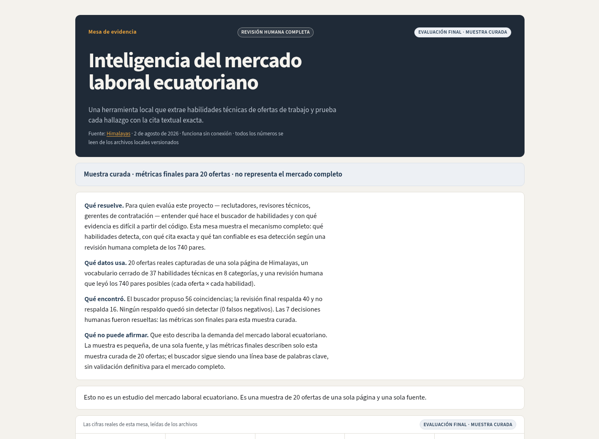
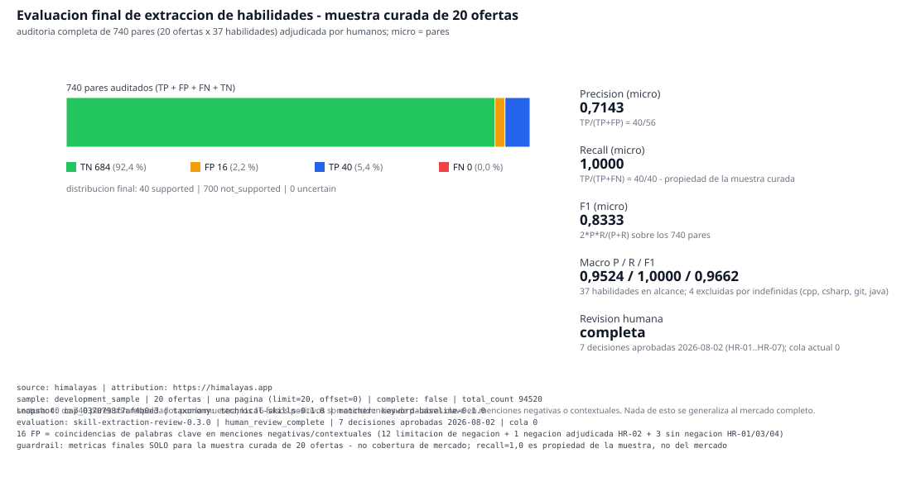
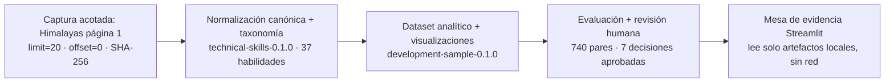

# Ecuador Job Market Intelligence

> Un producto de datos de extremo a extremo, Python-primero, que convierte ofertas públicas de empleo en una vista explorable y **basada en evidencia** de las habilidades que pide el mercado laboral de datos, IA y software en Ecuador y remoto.

**Estado:** `evaluation-final-for-curated-20-offer-sample` · `demo-ready` · `portfolio-ready` — la evaluación es **final solo para la muestra curada de 20 ofertas**, nunca una afirmación de cobertura de mercado.



*Captura real (Chromium/WebDriver) de la mesa de evidencia: un panel local de lectura sobre los cinco artefactos versionados bajo `data/`. Muestra `Revisión humana completa` y `Evaluación final · muestra curada`. No es una estadística oficial del mercado laboral.*

## 🧭 En una mirada

- **Qué es:** una mesa de evidencia local (Streamlit) sobre una captura **única y acotada** de Himalayas — 20 ofertas de la página 1 (`limit=20&offset=0`), conservadas byte por byte y verificadas con SHA-256.
- **Qué hace:** extrae habilidades con una línea base determinista de palabras clave (`keyword-baseline-0.1.0`, sin LLMs ni embeddings), documenta cada coincidencia con citas exactas y audita su calidad con una revisión humana completa.
- **Qué la hace honesta:** los 20 × 37 = 740 pares oferta × habilidad fueron etiquetados por una segunda pasada independiente y adjudicados por 7 decisiones humanas aprobadas (HR-01…HR-07, 2026-08-02). `recall = 1,0` es una propiedad de esta muestra curada, no del mercado.
- **Qué no es:** no es cobertura del mercado completo, no hay segunda fuente, no hay análisis semántico, y `no_evidence` no significa que una habilidad esté ausente.

## 🔎 Evidencia principal

La evaluación final (`data/evaluation/skill-extraction-review-0.3.0.json`, `human_review_complete`) audita los 740 pares completos de la muestra curada:



| Métrica | Valor (micro, 740 pares) |
| --- | --- |
| Contingencia | TP 40 · FP 16 · FN 0 · TN 684 |
| Precisión | 0,7143 (40/56) |
| Recall | 1,0 (40/40) — propiedad de la muestra curada |
| F1 | 0,8333 |
| Macro P / R / F1 | 0,9524 / 1,0 / 0,9662 (37 habilidades; 4 excluidas por indefinidas: `cpp`, `csharp`, `git`, `java`) |
| Distribución final | 40 `supported` · 700 `not_supported` · 0 `uncertain` |
| Revisión humana | completa · 7 decisiones aprobadas el 2026-08-02 · cola actual 0 |

Los 16 falsos positivos son coincidencias de palabras clave en menciones negativas o contextuales: 12 por la limitación de negación 0.1.0 documentada («No prior experience in AI is required») + 1 caso con negación adjudicado por revisión (HR-02) + 3 casos adjudicados sin negación (HR-01/03/04) = 16. Cada decisión queda registrada en el libro auditable `human_review_decisions`.

Visualizaciones descriptivas de línea base (frecuencia, cobertura por categoría, coocurrencia): `data/analytics/visualizations/development-sample-0.1.0/` — son evidencia descriptiva de palabras clave, no correlación ni representatividad.

## Cómo funciona



1. **Recolectar** — una captura única, acotada y autorizada (`totalCount` de la fuente: 94 520; snapshot `cap_0370798f7af4b0e3`, `complete: false`). Contrato y atribución: `docs/ingestion/himalayas-adapter-contract.md`.
2. **Normalizar y extraer** — proyección canónica valor-por-valor, taxonomía versionada y matcher determinista con citas exactas (campo, término, extracto, conteo).
3. **Analizar** — artefacto descriptivo y gráficas SVG/Markdown materializadas offline.
4. **Evaluar y auditar** — borrador → segunda pasada independiente (740/740 pares) → adjudicación humana de las 7 decisiones en cola → revisión final.
5. **Mostrar** — la mesa de evidencia renderiza solo los cinco artefactos locales y falla de forma cerrada si faltan o son inconsistentes.

La independencia de la anotación está probada: la segunda pasada etiqueta leyendo solo los campos de texto fuente (`title_raw`, `excerpt_raw`, `categories_raw`, `description_html_raw`) y nunca lee las predicciones del matcher al etiquetar. Detalle de la metodología y del libro de decisiones: [`docs/evaluation-review.md`](docs/evaluation-review.md) y [`docs/human-review-package.md`](docs/human-review-package.md).

## La muestra, en una tabla

| Hecho | Valor exacto |
| --- | --- |
| Captura | Himalayas `/jobs/api`, página 1, `limit=20&offset=0` |
| Snapshot | `cap_0370798f7af4b0e3` · raw SHA-256 `0370798f…ab101` (84 341 bytes) |
| Forma | `development_sample` · `complete: false` · `total_count` 94 520 |
| Calidad | 20/20 registros con evidencia · 0 campos faltantes · 0 duplicados |
| Frescura | 45 815,6095 s entre `updatedAt` de la fuente y la captura |
| Taxonomía | `technical-skills-0.1.0` · 37 habilidades en 8 categorías |
| Matcher | `keyword-baseline-0.1.0` · sin negación, sin semántica |

## Ejecutar la demo

```bash
uv sync --extra demo
uv run --extra demo streamlit run app/evidence_desk.py
```

- La app lee únicamente los artefactos versionados bajo `data/`; **no hace ninguna llamada de API en vivo** y falla de forma cerrada con un mensaje de recuperación ante artefactos faltantes o inconsistentes.
- El recorrido de 60–90 segundos está en [`docs/demo-script.md`](docs/demo-script.md).
- Validación offline de la suite: `uv run pytest` (ninguna prueba toca la red).
- Regenerar los artefactos de evaluación (offline, deterministas): `uv run python -m job_market_intelligence.analysis.materialize`, `…analysis.visualize`, `…analysis.evaluate` y `…analysis.finalize_review`.

## Para quién y qué responde

- **Estudiantes y candidatos de carrera temprana** que deciden qué aprender: ¿qué habilidades piden los roles de datos e IA?
- **Asesores de carrera y comunidades universitarias** que comparan demanda entre familias de roles.
- **Reclutadores** que exploran el panorama tecnológico local sin depender de percepciones.

Preguntas que el producto sabe responder con evidencia: qué habilidades técnicas son las más solicitadas, qué herramientas aparecen juntas en un mismo anuncio y dónde está la frontera entre una mención y un requisito real (los 16 FP documentados son exactamente esa frontera).

## Estructura

```text
app/evidence_desk.py                 mesa de evidencia (Streamlit, sin red)
src/job_market_intelligence/         paquete probado (ingestión + análisis)
  ├── ingestion/                     adaptador Himalayas, parser, almacenamiento
  └── analysis/                      taxonomía, matcher, dataset, evaluación, revisión
data/taxonomy/                       technical-skills-0.1.0.json
data/analytics/                      dataset de desarrollo + análisis + visualizaciones
data/evaluation/                     evaluación, segunda pasada y revisión final (v0.3.0)
data/manifests/                      manifiestos de captura (SHA-256, complete: false)
data/sample/                         fixtures offline para la suite de tests
docs/                                contratos, evaluación, brief y guion de demo
```

## ⚠️ Limitaciones

- **Una página, una fuente.** 20 ofertas de la página 1 de Himalayas (`complete: false`); no hay feed completo descargado ni segunda fuente. Himalayas es una bolsa de trabajo, no el mercado laboral ecuatoriano.
- **La evaluación es final solo para la muestra curada.** Las métricas describen exactamente estos 740 pares; no se generalizan y nunca se presentan como cobertura de mercado.
- **El matcher es una línea base de palabras clave.** No interpreta negación ni contexto (una mención «no se requiere IA» igual coincide con `skill.ai`), no usa LLMs, embeddings ni búsqueda semántica.
- **`no_evidence` ≠ ausencia.** Un registro sin coincidencias no demuestra que el puesto no pida la habilidad; una habilidad con 0 coincidencias en la muestra tampoco.
- **Taxonomía acotada a 37 habilidades.** SQL, Docker, Kubernetes y otras quedan fuera del alcance de 0.1.0.
- **Un solo snapshot de tiempo.** No hay series temporales, tendencias ni comparaciones entre capturas.

## Documentación

| Documento | Contenido |
| --- | --- |
| [`docs/evaluation-review.md`](docs/evaluation-review.md) | Método de evaluación, casos de frontera y métricas exactas |
| [`docs/human-review-package.md`](docs/human-review-package.md) | Relato histórico v0.2.0 y resolución aprobada HR-01…HR-07 |
| [`docs/ingestion/himalayas-adapter-contract.md`](docs/ingestion/himalayas-adapter-contract.md) | Contrato de la fuente, términos de uso y atribución |
| [`docs/evidence-desk-surface-brief.md`](docs/evidence-desk-surface-brief.md) | Brief de superficie (histórico v0.2, previo a la adjudicación) |
| [`docs/demo-script.md`](docs/demo-script.md) | Guion del recorrido de la demo |
| [`PRODUCT.md`](PRODUCT.md) · [`DESIGN.md`](DESIGN.md) | Visión de producto y decisiones de diseño |

Artefactos de datos versionados: `data/analytics/development-sample-0.1.0.json` (dataset + informe de calidad embebido), `data/analytics/descriptive-development-sample-0.1.0.json`, `data/taxonomy/technical-skills-0.1.0.json`, `data/evaluation/skill-extraction-review-0.3.0.json` y su informe (v0.2.0 conservado como histórico). Los estados de máquina (`evaluation-final`, `human-reviewed`) se derivan de los artefactos; la interfaz muestra el aviso `Muestra curada · métricas finales para 20 ofertas · no representa el mercado completo`.

## Estado y hoja de ruta

Completado: ingesta acotada con conservación raw byte-exacta · taxonomía y matcher de línea base · dataset de desarrollo con informe de calidad · análisis descriptivo y coocurrencia · evaluación de borrador · segunda pasada independiente (740/740 pares) · adjudicación humana de las 7 decisiones · mesa de evidencia Streamlit con captura real congelada.

Pendiente (explícito): reportes de frescura/calidad más allá de la muestra · normalización de títulos y senioridad · segunda fuente autorizada · búsqueda semántica **solo después** de medir la línea base · FastAPI/PostgreSQL cuando el MVP lo justifique · despliegue público o recorrido grabado.

## Licencia

**Código original.** MIT (ver `LICENSE`).

**Datos y contenido de terceros.** Los datos de fuente, capturas raw, manifests, fixtures, citas y demás contenido externo no quedan cubiertos por MIT: conservan sus términos independientes documentados (ver `docs/ingestion/himalayas-adapter-contract.md`) y se muestran bajo el requisito de atribución de [himalayas.app](https://himalayas.app). No se otorga ningún derecho implícito sobre material de terceros.
